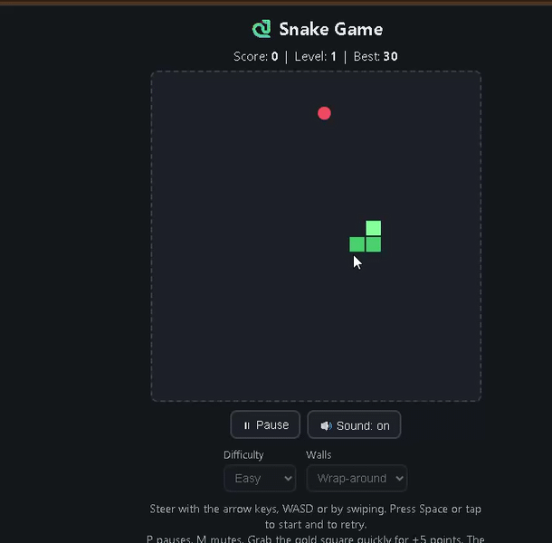

# 🐍 Snake Game

▶ **Play online:** https://sefa177.github.io/snake-game/

A small retro snake game that runs in the browser. Plain HTML, CSS and JavaScript, no installation required.

## How to play
- Steer with the arrow keys or WASD (PC), or swipe / use the on-screen arrows (phone)
- Press Space (PC) or tap the game (phone) to start / retry
- Eat the red food to grow and score points; don't hit yourself (or the walls, in Solid mode)
- Gold squares appear now and then: grab one quickly for +5 points before it vanishes
- The game speeds up every 5 foods (level up)

## Features
- **Difficulty:** Easy, Medium or Hard sets how fast the game starts and how fast it can get
- **Walls:** Solid (walls kill you) or Wrap-around (pass through a wall and come out the other side, shown with a dashed border)
- **Pause:** press P (or Esc), use the Pause button, or tap the game while paused. The game also pauses by itself when you switch tabs
- **Top 5 scores:** saved in your browser, with level, difficulty and wall mode
- **Retro beep sounds:** press M or use the button to mute
- Works on desktop and phones

## Running it
Play it online: https://sefa177.github.io/snake-game/

To run it locally, start a small web server in the project folder (opening `index.html` directly no longer works, because the browser will not load the `.wasm` file from disk):

    python -m http.server 8000

Then open http://localhost:8000.

## Built with
- **Rust compiled to WebAssembly:** the game rules (movement, input buffer, collisions, gold food, levels, win condition) live in `rust/src/lib.rs` and are built to `snake_core.wasm`
- **JavaScript:** canvas drawing, sound (Web Audio), keyboard and touch input, the game timer and the local high-score table
- Rebuild the engine with `sh build.sh` (needs Rust and the `wasm32-unknown-unknown` target)
